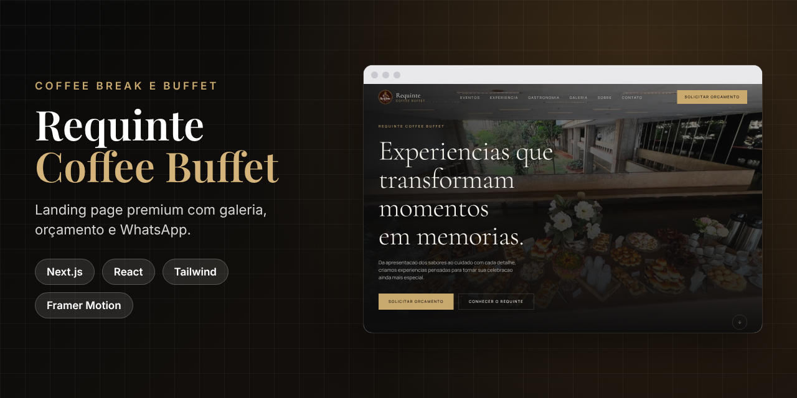
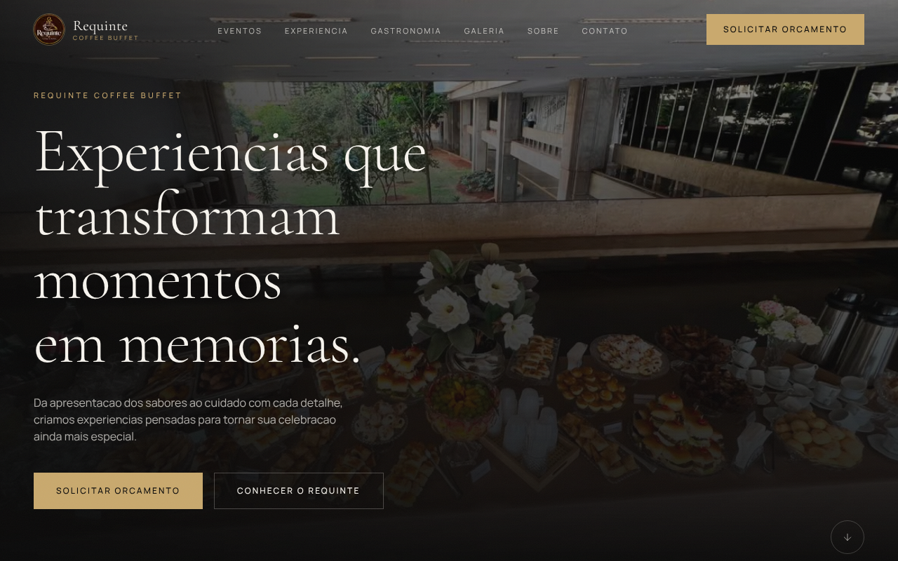
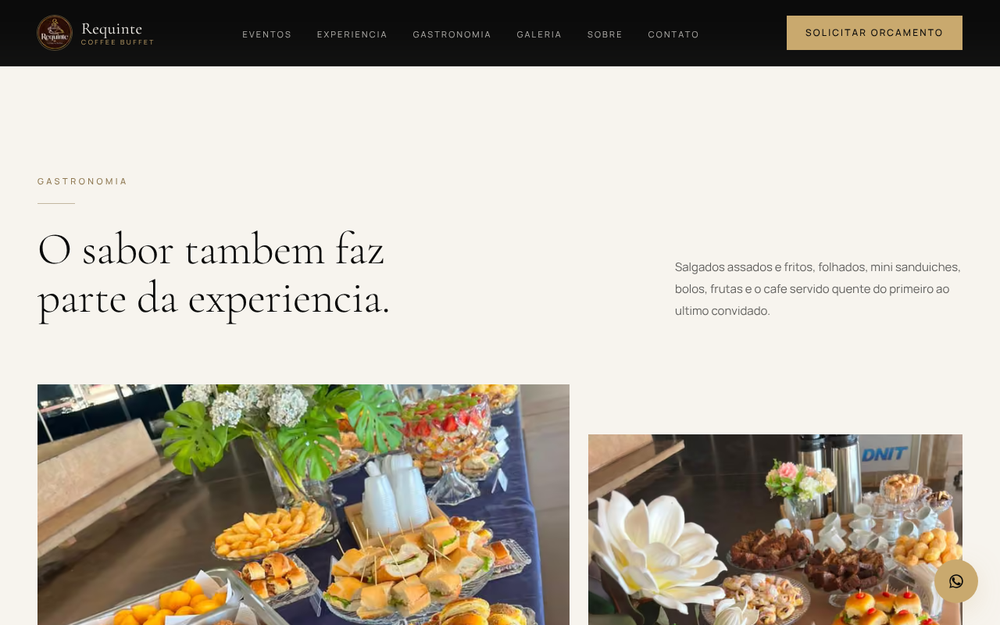
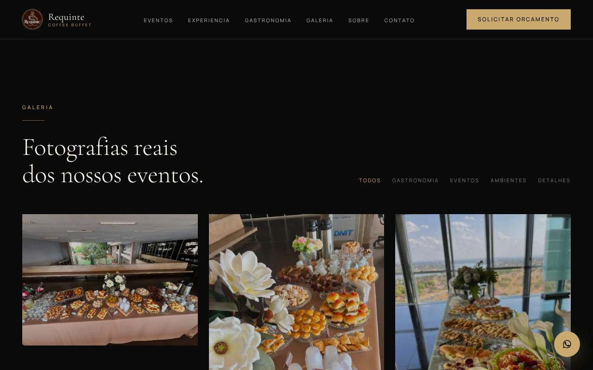
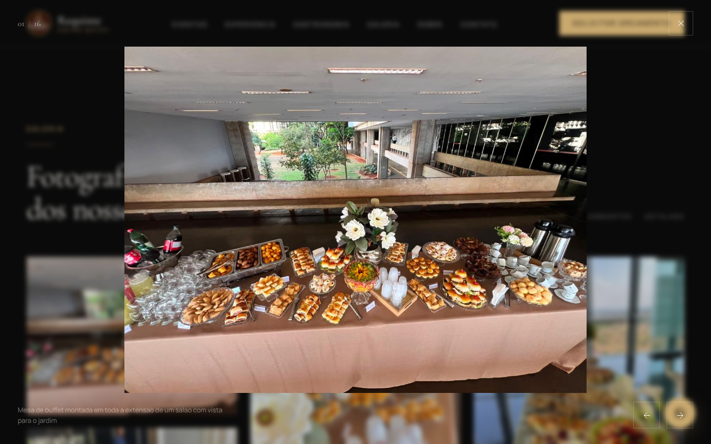
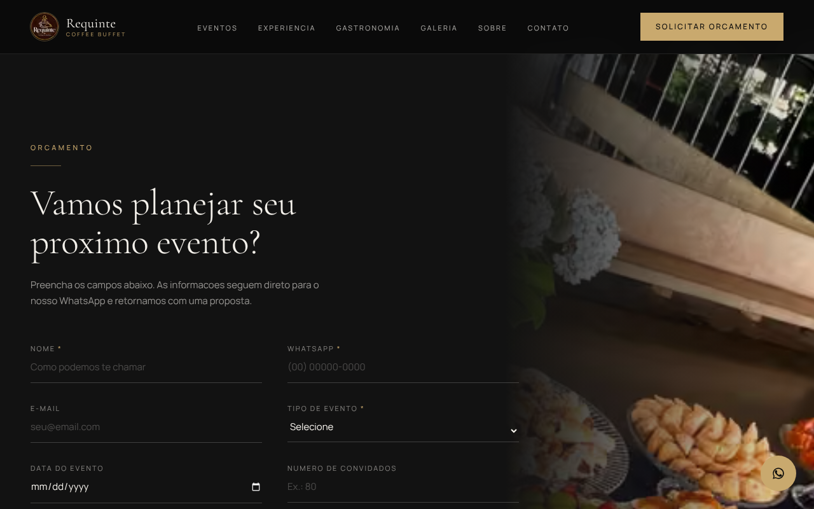
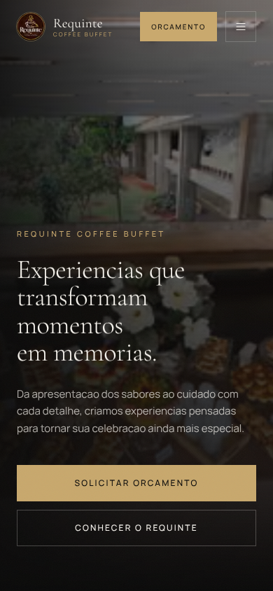

<p align="center">
  
</p>

<h1 align="center">☕ Requinte Coffee Buffet — Landing Page</h1>

<p align="center">
  Landing page premium para o <b>Requinte Coffee Buffet</b>: gastronomia, galeria de fotos reais dos eventos,
  dúvidas frequentes e um <b>formulário de orçamento</b> que envia o pedido pronto para o <b>WhatsApp</b>.
</p>

<p align="center">
  
  
  
  
  
  
</p>

<p align="center">
  <a href="#-sobre-o-projeto">Sobre</a> •
  <a href="#-funcionalidades">Funcionalidades</a> •
  <a href="#-telas">Telas</a> •
  <a href="#-como-executar">Como executar</a> •
  <a href="#-deploy-na-vercel">Deploy</a> •
  <a href="#-conteúdo-pendente">Conteúdo pendente</a> •
  <a href="#-estrutura-do-projeto">Estrutura</a> •
  <a href="#-notas-técnicas">Notas técnicas</a>
</p>

---

## 📌 Sobre o projeto

Site institucional de uma página para o **Requinte Coffee Buffet**, feito em **Next.js 15 (App Router)**,
TypeScript, Tailwind CSS, Framer Motion e Lucide React. A página apresenta os tipos de evento atendidos, a
gastronomia, uma galeria com as fotos reais dos eventos e o processo de contratação, e termina num formulário de
orçamento que abre o WhatsApp com a mensagem já montada.

Todo o texto do site fica num único arquivo, [`content/site.ts`](content/site.ts). Nada foi inventado: onde
faltava informação oficial ficou um marcador visível (veja [Conteúdo pendente](#-conteúdo-pendente)).

## ✨ Funcionalidades

| | Recurso | Descrição |
|---|---|---|
| 🍰 | **Seções da página** | Hero, posicionamento, eventos, gastronomia, carrossel de experiências, galeria, diferenciais, processo, depoimentos, sobre, FAQ e Instagram |
| 🖼️ | **Galeria com filtros** | Fotos reais filtradas por gastronomia, eventos, ambientes e detalhes |
| 🔍 | **Lightbox** | Foto ampliada com legenda, contador, setas e `ESC` para fechar |
| 🎠 | **Carrossel de experiências** | Navegação por setas do teclado e indicadores |
| 📝 | **Formulário de orçamento** | Nome, WhatsApp, e-mail, tipo e data do evento e convidados; abre o WhatsApp com tudo preenchido |
| 💬 | **WhatsApp** | Botão flutuante e CTAs; o número vem de variável de ambiente (sem ela, os links caem no Instagram) |
| 🔎 | **SEO** | Metadata, Open Graph, `sitemap.xml`, `robots.txt` e dados estruturados Schema.org `LocalBusiness` |
| ♿ | **Acessibilidade** | Skip link, foco visível, foco preso no lightbox, `aria-label` e `prefers-reduced-motion` |
| 📱 | **Responsivo** | Menu mobile em tela cheia e layout sem rolagem lateral |

## 🖼️ Telas

<table>
  <tr>
    <td align="center"><b>Página inicial</b><br></td>
    <td align="center"><b>Gastronomia</b><br></td>
  </tr>
  <tr>
    <td align="center"><b>Galeria</b><br></td>
    <td align="center"><b>Foto ampliada</b><br></td>
  </tr>
  <tr>
    <td align="center"><b>Formulário de orçamento</b><br></td>
    <td align="center"><b>Celular</b><br></td>
  </tr>
</table>

## 🚀 Como executar

**Pré-requisito:** Node.js 18.18 ou superior.

```bash
git clone https://github.com/kauaxp77/Requinte_coffee.git
cd Requinte_coffee
npm install
npm run dev
```

Produção:

```bash
npm run build
npm start
```

Checagem de tipos: `npm run typecheck`.

### Configuração obrigatória antes de publicar

Copie `.env.local.example` para `.env.local` e preencha:

| Variável | Para que serve |
| --- | --- |
| `NEXT_PUBLIC_WHATSAPP_NUMBER` | Número em formato internacional, só dígitos (ex.: `5561999999999`). Alimenta o botão flutuante, os CTAs e o envio do formulário. **Sem ele, todos os links de WhatsApp caem no Instagram** — nenhum telefone foi inventado no código. |
| `NEXT_PUBLIC_SITE_URL` | Domínio público. Usado em canonical, Open Graph, sitemap e structured data. |
| `NEXT_PUBLIC_CONTACT_EMAIL` | E-mail comercial exibido no rodapé (opcional). |

## ▲ Deploy na Vercel

O projeto é Next.js padrão — a Vercel detecta tudo sozinha (build `next build`, output `.next`, install `npm ci` a
partir do `package-lock.json`). Não há `vercel.json`: nenhuma configuração extra é necessária.

Importar o repositório:

1. Abra <https://vercel.com/new> e importe `kauaxp77/Requinte_coffee`.
2. Framework Preset: **Next.js** (já vem detectado). Não mude build nem output.
3. Em **Environment Variables**, adicione as três antes do primeiro deploy — elas são `NEXT_PUBLIC_*`, ou seja,
   entram no bundle **em tempo de build**: mudar depois exige um novo deploy (Redeploy), não basta salvar.

| Variável | Valor | Se faltar |
| --- | --- | --- |
| `NEXT_PUBLIC_WHATSAPP_NUMBER` | `5561XXXXXXXXX` — só dígitos, com 55 e DDD | Todos os botões de WhatsApp caem no Instagram |
| `NEXT_PUBLIC_SITE_URL` | O domínio final, ex.: `https://requintecoffeebuffet.com.br` | Canonical, Open Graph e sitemap apontam para o domínio padrão do código |
| `NEXT_PUBLIC_CONTACT_EMAIL` | E-mail comercial (opcional) | O rodapé mostra `[INSERIR E-MAIL OFICIAL]` |

Cada push na branch `main` gera um novo deploy de produção automaticamente.

Pela CLI, se preferir:

```bash
npm i -g vercel
vercel login
vercel link
vercel env add NEXT_PUBLIC_WHATSAPP_NUMBER production
vercel --prod
```

## 📝 Conteúdo pendente

Todo texto do site vive em [`content/site.ts`](content/site.ts). Nada foi inventado: onde faltava informação
oficial ficou um marcador visível. Procure por `[INSERIR` e `[INFORMACAO A CONFIRMAR` para achar tudo de uma vez:

```bash
grep -n "\[INSERIR\|\[INFORMACAO A CONFIRMAR" content/site.ts
```

Pendências atuais:

- história oficial da empresa, equipe e ano de fundação (seção Sobre);
- endereço, horário de atendimento e e-mail (rodapé);
- respostas de FAQ sobre mínimo de convidados, contratação, deslocamento e formatos de casamento;
- depoimentos reais. A seção de prova social já está pronta: basta adicionar objetos `{ quote, author, role }` em
  `testimonialsSection.items` que ela passa a exibir os depoimentos no lugar do aviso.

## 📷 Imagens

As 17 fotos originais foram renomeadas e organizadas em `public/images/requinte/` com nomes semânticos
(`requinte-01-mesa-panoramica.jpg` etc.). Os originais continuam em `imagens_fic/` e não são usados pela aplicação.

Cada foto tem `alt` descritivo e categoria (gastronomia, eventos, ambientes, detalhes) definidos em
`content/site.ts`. Para trocar uma foto de seção, basta apontar outra chave de `photos` — nenhum componente precisa
mudar.

## 📨 Formulário de orçamento

O envio monta uma mensagem com todos os campos e abre o WhatsApp em nova aba, depois mostra a confirmação na
própria página. Não há backend nem banco de dados. Para receber os pedidos por e-mail ou CRM, troque o corpo de
`onSubmit` em [`components/QuoteForm.tsx`](components/QuoteForm.tsx) por uma chamada a uma API route.

## 📁 Estrutura do projeto

```
Requinte_coffee/
├── app/
│   ├── layout.tsx          # Metadata, fontes e structured data (Schema.org LocalBusiness)
│   ├── page.tsx            # Composição das seções
│   ├── globals.css         # Tokens, botões e campos de formulário
│   ├── sitemap.ts          # sitemap.xml
│   └── robots.ts           # robots.txt
├── components/             # Uma seção por arquivo + Reveal e Lightbox compartilhados
├── content/site.ts         # Todo o conteúdo editorial
├── lib/                    # Helper do WhatsApp e hook de montagem dos overlays
├── public/images/requinte/ # Fotos usadas no site
├── imagens_fic/            # Fotos originais (não usadas pela aplicação)
├── design/                 # Protótipos de design (HTML) e imagens de referência
├── docs/                   # Banner e capturas de tela deste README
├── .env.local.example      # Modelo das variáveis de ambiente
└── package.json
```

## ⚙️ Notas técnicas

- `framer-motion` está fixado em `~11.18.2`. A linha 12.x não hidrata as animações nesta combinação de
  Next 15 + React 19 — a página renderiza no estado inicial (elementos invisíveis). Não suba a versão sem testar no
  navegador.
- Os overlays em tela cheia (lightbox e menu mobile) usam `lib/useMountTransition.ts` em vez de
  `AnimatePresence`: com React 19 em StrictMode o `AnimatePresence` pode não desmontar o filho após a saída,
  deixando um overlay invisível por cima da página e bloqueando os cliques.
- Acessibilidade: HTML semântico, skip link, foco visível, foco preso no lightbox, `ESC` fecha lightbox e menu,
  setas navegam carrossel e lightbox, todos os controles com `aria-label`, `prefers-reduced-motion` respeitado.
- Sem overflow horizontal em 320, 375, 430, 768, 1024, 1280, 1440, 1920 px.

## 🛠️ Tecnologias

- **Next.js 15** (App Router, páginas estáticas) e **React 19**
- **TypeScript**
- **Tailwind CSS 3** (com PostCSS e Autoprefixer)
- **Framer Motion**: animações de entrada e transições
- **Lucide React**: ícones
- **Vercel**: hospedagem

## 👨‍💻 Autor

Desenvolvido por **[kauaxp77](https://github.com/kauaxp77)** para o Requinte Coffee Buffet

<p align="center">⭐ Se curtiu o projeto, deixe uma estrela!</p>
